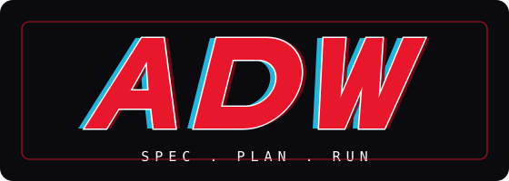

<p align="center"></p>

The spec, plan, run pipeline for Claude Code: `/adw:spec` writes the spec, `/adw:plan-tdd` writes the test-driven plan, and `/adw:next` executes it in chunk-paced attended batches or unattended to a pull request, with deterministic gates holding the line for code and graded evals holding it for model behavior.

[](https://github.com/ryanmat/adw/actions/workflows/ci.yml) [](https://github.com/ryanmat/adw/releases/latest) [](LICENSE)

## Overview

A Claude Code plugin plus the methodology it implements. The plugin carries three slash commands, two run agents and a brownfield spec-mining agent, four hooks, standard-library Python scripts, and a Markdown deliverables skill, with their tests and an eval harness. Nothing here is standing agent context: every piece is loaded by the plugin system on demand or read by a person.

The policies that matter are code, not prompt text. A guard hook denies hook bypasses in every session and, while an unattended run is live, denies merges, force pushes and destructive git. A Stop hook holds an attended turn until the plan's Test passes. A deterministic gate between the implementer and each commit proves the step's new tests fail on the base commit, refuses staged secrets and toolchain files, and compares test counts against the baseline so a step cannot reach green by shrinking the suite. An unattended run never merges.

The repository root is the plugin and its own single-plugin marketplace, so git tags carry the versions and the installed record's commit SHA is the drift check.

## Setup

Python 3.12 or later on `PATH` as `python3`. Install at user scope, pinned to a release tag:

```bash
claude plugin marketplace add ryanmat/adw@v3.5.8
claude plugin install adw@adw --scope user
```

Unattended runs need an owner allow-list before they do anything. Set it in the `env` block of `~/.claude/settings.json`, as the GitHub owners whose repositories a run may target:

```json
{
  "env": {
    "ADW_OWNERS": "your-github-login,your-org"
  }
}
```

With no `ADW_OWNERS`, every preflight refuses. The attended loop needs no configuration.

What installing the plugin turns on, in every session, is listed under Layout, `hooks/`. The guard's hook-bypass denial applies everywhere; the rest arms only inside a plan or a run.

Two machines agree when their installed records carry the same commit SHA:

```bash
python3 -c 'import json,os;d=json.load(open(os.path.expanduser("~/.claude/plugins/installed_plugins.json")));print(json.dumps({k:v for k,v in d.items() if "adw" in k},indent=1))'
```

Permission deny rules cannot ship in a plugin; they stay in user settings.

## Usage

In the target repository:

```text
/adw:spec <idea in 2-4 sentences>      # interview mode; quick: and v0: are the other two
git add spec.md && git commit -m "docs: add spec for <feature>"
/adw:plan-tdd                          # spec.md -> prompt_plan.md, validated
git add prompt_plan.md && git commit -m "docs: implementation plan for <feature>"
/adw:next                              # runs to the end of the current chunk, then reports
```

`/adw:next` writes the failing test first, implements to green, runs the deterministic `check`, commits with hooks passing, marks the step done, and stops at the chunk boundary with the evidence and the reviewer's verdict. Say continue for the next chunk.

For a plan that is already decomposed into mechanical steps, `/adw:next auto [N]` runs up to N steps unattended in a worktree and ends at a labeled pull request. It is hold-only: a person merges, through the gate, with `python3 <installPath>/scripts/next_auto.py merge <n>`.

The methodology is `ai-dev-workflow.md`; the moves without the reasoning are `workflow-runbook.md`.

## Intents and traceability

Above a spec sits an intent: the outcome a set of units of work serves, carried by an id such as `30.1`. The engine never writes one. It reads them, so that every pull request traces back to the intent it serves, through two conventions:

- A pull request body carries the trailer lines `Spec: <slug>`, `Closes: <requirement ids>`, `Intent: <intent ids>` and `Approved-by: @<login>`. An unattended run writes the first, second and fourth at wrap-up, from the plan header, the DONE steps and the delivery record; the `Intent:` line is the author's. The projection reads the first line of each.
- `docs/setup-plan.md` in the project carries a `## Intents` section whose `### Now` table has an `Intent` column and a `Specs` column, mapping each live intent to the specs that serve it. The landed report fills its Intent cell from that table when a pull request names a spec and no intent.

`scripts/next_projection.py` builds a SQLite store from a checkout and answers typed questions from it; no query takes SQL:

```bash
python3 <installPath>/scripts/next_projection.py build --target <checkout>
python3 <installPath>/scripts/next_projection.py query intent 30.1
python3 <installPath>/scripts/next_projection.py query coverage <capability-slug>
```

`query intent` lists the intent's merged pull requests with their deploy and its open ones in base-chain order; `query coverage` lists a capability's requirements and the pull requests that close them. `query entity`, `find`, `neighbors`, `path` and `timeline` walk the same store.

## Layout

- `ai-dev-workflow.md` - the methodology: surfaces and their jobs, weight classes, the five phases including unattended execution, config placement.
- `workflow-runbook.md` - the step-by-step operating procedure; the moves without the reasoning.
- `.claude-plugin/` - `plugin.json` (name `adw`, version) and `marketplace.json` (one plugin, sourced from this root).
- `commands/` - `spec.md` (`/adw:spec`: interview, quick, and v0 pre-discovery modes), `plan-tdd.md` (`/adw:plan-tdd`), and `next.md` (`/adw:next`, the chunk-paced attended loop and `/adw:next auto`).
- `agents/` - `next-implementer.md` and `next-reviewer.md`, dispatched as `adw:next-implementer` and `adw:next-reviewer` by an unattended run; `spec-miner.md`, dispatched as `adw:spec-miner` by the operator to mine a brownfield codebase into the baseline `spec.md` that `/adw:plan-tdd` plans against.
- `hooks/` - `hooks.json` registers `next-guard.py` on `PreToolUse` for `Bash` and `Edit|Write|MultiEdit`: it denies hook bypasses everywhere, and merges, force pushes, and destructive git while a run is live; and `stop-gate.py` on `Stop`: while `prompt_plan.md` has an open step and the tree has changes beyond the plan and the record, a turn ends only on a green Test run, and the fourth stop on one failure is allowed; and `ruling-log.py` on `PostToolUse` for `AskUserQuestion`: one line per answered question in the ruling store, `.next-auto/rulings/<session id>.jsonl` under the project dir, written only in a project where that directory already exists; and `ruling-recall.py` on `PreToolUse` for `AskUserQuestion`: the rulings of the last 48 hours that share a word with the new question, as the reason of a deny while any of them has not been shown to the session, so the model reads them before the person sees the question; the dialog asked again goes ahead.
- `scripts/next_plan.py` - the plan grammar: validate, migrate, status, next, brief, plan-hash, byte-preserving status and section edits, and the `ruling add` and `ruling recall` commands over `scripts/rulings.py`.
- `scripts/next_auto.py` - every git and gh operation of an unattended run, plus the deterministic gate, the attended `check` and `commit`, the merge gate, and the delivery record's call points for a plan whose Conventions carry `Record`.
- `scripts/next_projection.py` - the delivery projection: a SQLite view over records, specs, pull requests and their trailers, intents, rulings and ledgers, with its typed queries.
- `skills/markdown/SKILL.md` - the house-style Markdown deliverables skill; also uploadable to Claude Desktop via Settings > Features > Skills.
- `tests/` - the suite for the scripts, the hooks, the command grammar, and the plugin layout. Real git repos with a local bare origin, no mocks. Fixtures are synthetic: the plans and records under `tests/fixtures/` keep the structure of real ones with their free text regenerated.
- `evals/next-auto/` - scenario evals for unattended runs, graded on git and PR state rather than by a judge. They drive the real CLI against a fixture repository you own and record cost per scenario.
- `evals/lib/` - the git fixture builder and the eval ledger record the tests and the harness share.

## Configuration

Read from the environment, which for Claude Code means the `env` block of the user's settings.

| Variable | Default | Effect |
|---|---|---|
| `ADW_OWNERS` | unset | Comma-separated GitHub owners whose repositories `/adw:next auto` may target. Unset, preflight, start and merge refuse. |
| `ADW_NEVER_AUTO` | empty | Comma-separated `owner/repo` slugs that are never an unattended target, refused before any network call. |
| `ADW_DONE_REVIEWER` | `done-check` | The reviewer name a done-check verdict record carries; `verdict` writes it and `merge` requires it. |
| `ADW_EVAL_FIXTURE_REPO` | unset | The `owner/repo` the eval harness resets and drives; its `baseline` tag holds `evals/next-auto/fixtures/baseline/`. Evals only. |

## Working on the code

```bash
uv sync
uv run pytest                               # scripts, hooks, the docs-grammar guards, and the plugin layout
uv run ruff check .
uv run --isolated --python 3.12 pytest -q   # the floor the scripts run on
claude plugin validate --strict .
claude --plugin-dir .                       # load the working tree as the plugin without installing it
```

Editing a source changes nothing on an installed machine until a new tag is cut and the machine re-pins to it; a working tree loaded with `--plugin-dir` runs the source directly.

Eval runs need `gh` authenticated as a user who can push to the fixture repository, and they cost real money:

```bash
export ADW_EVAL_FIXTURE_REPO=<owner>/<repo>
python3 evals/next-auto/run_scenario.py --list
python3 evals/next-auto/run_scenario.py refuse-foreign-owner    # the cheap one
python3 evals/next-auto/run_scenario.py                         # all scenarios
```

They reset the fixture repository to its `baseline` tag, drive the real Claude Code CLI against it with the working tree loaded as the plugin and the scenario's cost cap as the CLI's hard budget, and write per-scenario results with `total_cost_usd` to `evals/next-auto/results/`. A lock file serializes them, because they share one remote.

## License

Apache-2.0. See `LICENSE` and `NOTICE`.
